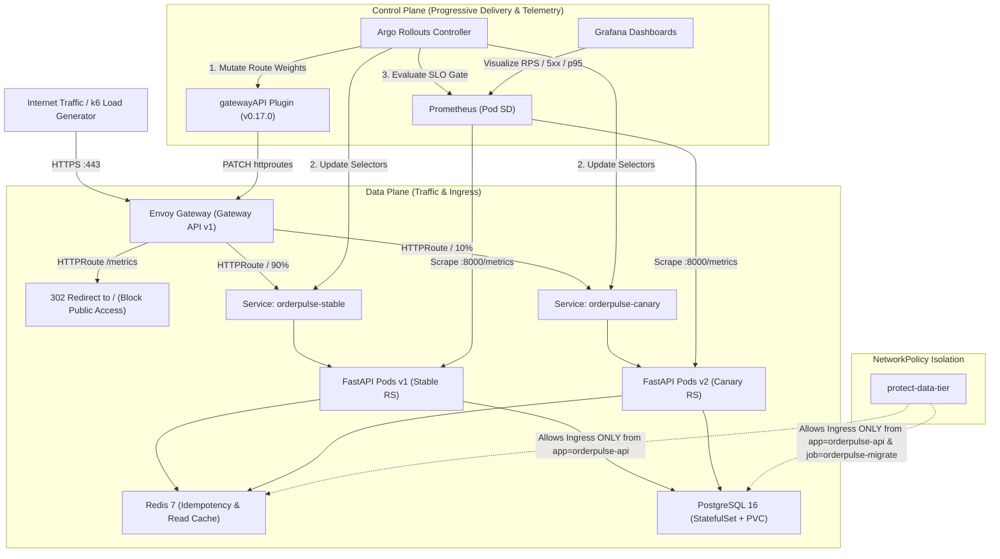

# OrderPulse • Zero-Downtime Stateful Progressive Delivery Platform

[](https://github.com/arnab-580/zero-downtime-deployment-system/actions)
[](https://opensource.org/licenses/MIT)
[-orange)](https://gateway-api.sigs.k8s.io/)
[](https://argoproj.github.io/argo-rollouts/)
[](https://www.postgresql.org/)
[](https://redis.io/)

OrderPulse is an enterprise-grade cloud-native delivery engine designed to solve the hardest problem in progressive delivery: **zero-downtime releases for stateful microservices**. 

It pairs modern **Kubernetes Gateway API (Envoy Gateway)** with **Argo Rollouts**, automated **Prometheus SLO analysis gates**, and backward-compatible **PostgreSQL 16 Expand-and-Contract migrations** to guarantee 0 dropped requests and sub-minute automated rollback under real concurrent traffic.

---

## 🏗️ High-Level System Architecture



---

## ⚡ The 5 Engineering Pillars of Zero-Downtime

| Pillar | Industry Problem | OrderPulse Solution |
| :--- | :--- | :--- |
| **1. Modern L7 Ingress** | Community `ingress-nginx` reached **End-of-Life in March 2026**; annotation-based traffic weights lack portability. | Implements official **Kubernetes Gateway API (`Gateway` + `HTTPRoute`)** powered by **Envoy Gateway v1.10**. Dynamic xDS weight updates shift traffic in milliseconds without reloading proxy processes. |
| **2. Zero-Downtime State** | Deploying new database schemas while old and new app versions run simultaneously causes schema collision and locks. | **Expand-and-Contract Migration Pattern** using Alembic and PostgreSQL 16. Uses `pg_advisory_lock` to serialize migrations, instant metadata default additions, and `CREATE INDEX CONCURRENTLY` in `autocommit_block()`. |
| **3. Packet-Draining Pod Lifecycle** | Kubernetes removes pod IPs from endpoints asynchronously with sending `SIGTERM`, causing in-flight requests to drop (502s). | Container `lifecycle.preStop` executes `sleep 10` before `SIGTERM`. Server keep-alive (`65s`) exceeds Envoy idle timeout (`60s`), and Uvicorn drains connections over `20s`. |
| **4. Scoped SLO Telemetry** | Scraping load-balanced Service ClusterIPs alternates pods on every scrape, corrupting rate counters. Exposing `/metrics` publicly leaks internal state. | Prometheus uses **Kubernetes Pod Service Discovery** stamped with `rollouts_pod_template_hash`. Public `/metrics` is blocked at the Gateway; internal queries isolate canary pods specifically. |
| **5. Automated Auto-Rollback** | Custom bash/Node scripts wrapping `kubectl` are fragile, lack metrics feedback loops, and introduce command injection risks. | **Argo Rollouts `AnalysisTemplate`** queries Prometheus every 20s. If canary 5xx error rate exceeds 1% or p95 exceeds 250ms across 2 checks, traffic automatically reverts to 100% stable in < 60s. |

---

## 📊 Mathematical Zero-Downtime Proofs (k6 Verification)

### Experiment A: Successful Canary Promotion (v1.0.0 → v2.0.0)
Continuous read (`GET /api/products`) and transactional checkout write (`POST /api/orders`) traffic fired during live schema migration and canary progression (10% → 25% → 50% → 100%):

```text
  █ THRESHOLDS 

    http_req_duration
    ✓ 'p(95)<500' p(95)=51.35ms

    http_req_failed
    ✓ 'rate==0' rate=0.00%


  █ TOTAL RESULTS 

    checks_total.......: 6301    29.954781/s
    checks_succeeded...: 100.00% 6301 out of 6301
    checks_failed......: 0.00%   0 out of 6301

    ✓ GET /api/products 200
    ✓ POST /api/orders 201

    HTTP
    http_req_duration..............: avg=48.39ms min=40.49ms med=45.12ms max=341.97ms p(90)=48.95ms p(95)=51.35ms 
    http_req_failed................: 0.00%  0 out of 6301
    http_reqs......................: 6301   29.954781/s
    vus............................: 3      min=2         max=7
```
**Result**: **0 dropped requests** across 6,301 total HTTP requests over the public internet with HTTPS.

---

### Experiment B: Automated SLO-Gated Rollback (v2.1.0-buggy)
A release configured with injected chaos (`CHAOS_ERROR_RATE: "0.20"`) was promoted to canary:
1. Canary scaled up and received 10% traffic.
2. Prometheus measured an instantaneous 13.36% 5xx error rate on pod hash `598dcdf647`.
3. `AnalysisRun` failed after exceeding `failureLimit: 2`:
   ```text
   Warning  AnalysisRunFailed  6s  rollouts-controller  Background Analysis Run 'orderpulse-api-598dcdf647-3' Status New: 'Failed'
   Warning  RolloutAborted     6s  rollouts-controller  Rollout aborted update to revision 3: Background analysis phase error/failed: Metric "canary-5xx-error-rate" assessed Failed due to failed (3) > failureLimit (2)
   ```
4. Envoy Gateway immediately reset weights to **100% stable / 0% canary**.
5. Faulty canary pod was automatically terminated within 45 seconds of first traffic impact.

---

## 🛠️ Complete Technical Stack

| Layer | Component | Description |
| :--- | :--- | :--- |
| **API Framework** | Python 3.12 • FastAPI • Uvicorn | Async REST API serving transactional endpoints with connection pooling (`psycopg_pool`) and structured JSON logging. |
| **Data Layer** | PostgreSQL 16 • Alembic | Stateful relational persistence (StatefulSet + 2Gi PVC) executing zero-downtime Expand-and-Contract migrations with advisory locking. |
| **Cache & Deduplication** | Redis 7 (`redis.asyncio`) | In-memory catalog caching and distributed idempotency key storage (`Idempotency-Key` header) preventing duplicate order placement. |
| **Ingress & Networking** | Kubernetes Gateway API • Envoy Gateway v1.10 | Modern L7 routing engine handling TLS termination, HTTP→HTTPS 301 redirection, and weighted canary traffic splitting. |
| **Progressive Delivery** | Argo Rollouts • Gateway API Plugin v0.17 | Native Kubernetes controller automating weighted canary traffic shifts and Prometheus metric evaluation. |
| **Observability** | Prometheus v3.2 • Grafana v11.5 | Pod-scoped service discovery scraping application latency histograms and status code counters; pre-provisioned Grafana dashboards. |
| **Supply Chain Security** | GitHub Actions • Ruff • Pytest • Trivy • GHCR | Automated linting, testing, single container build, and Trivy CVE scanning before pushing immutable digest-tagged images. |
| **Infrastructure as Code** | Terraform • AWS VPC • EC2 k3s | Reproducible cloud provisioning: custom VPC (10.0.0.0/16), public subnet, Internet Gateway, locked Security Groups, and IMDSv2 hardened EC2 node. |
| **TLS & PKI** | cert-manager v1.21 • Let's Encrypt | Automatic ACME HTTP-01 certificate issuance and renewal via Gateway API HTTPRoute solver for `.sslip.io` domain. |

---

## 🚀 Quickstart & Reproduction Guide

### Local Development ($0 Cost via k3d)
```bash
# 1. Create local cluster with built-in Traefik disabled
k3d cluster create orderpulse --k3s-arg "--disable=traefik@server:0" -p "8080:80@loadbalancer"

# 2. Install Envoy Gateway & Gateway API CRDs
helm install eg oci://docker.io/envoyproxy/gateway-helm --version v1.10.0 -n envoy-gateway-system --create-namespace

# 3. Install Argo Rollouts with Gateway API Plugin
helm repo add argo https://argoproj.github.io/argo-helm
helm install argo-rollouts argo/argo-rollouts --version 2.43.8 -n argo-rollouts --create-namespace -f k8s/platform/argo-rollouts-values.yaml

# 4. Deploy Platform & Workload Manifests
kubectl apply -f k8s/namespace.yaml
kubectl apply -f k8s/platform/
kubectl apply -f k8s/workloads/
```

### AWS Production Cloud (via Terraform)
```bash
cd infra/terraform
terraform init
terraform plan
terraform apply
```
After deployment, copy the kubeconfig and point your workstation kubectl to the AWS cluster:
```powershell
$EIP = (terraform output -raw elastic_ip)
scp -i "$HOME\.ssh\orderpulse-aws" ubuntu@${EIP}:/home/ubuntu/.kube/config "$HOME\.kube\aws-orderpulse.yaml"
$env:KUBECONFIG = "$HOME\.kube\aws-orderpulse.yaml"
kubectl get nodes -o wide
```

---

## 🔒 Security & Hardening Model

1. **Non-Root Containers**: All application pods run under dedicated UID `1001` (`runAsNonRoot: true`, `readOnlyRootFilesystem: true`, `allowPrivilegeEscalation: false`, `capabilities.drop: ["ALL"]`).
2. **Kubernetes NetworkPolicy**: The data tier (`postgres` and `redis`) is strictly isolated by `protect-data-tier`. Direct ingress is permitted only from pods labeled `app=orderpulse-api` or `job=orderpulse-migrate`.
3. **IMDSv2 Enforced**: AWS EC2 instance metadata tokens are strictly required (`http_tokens = "required"`), eliminating SSRF credential exfiltration vulnerabilities.
4. **Zero Public Metrics**: Public internet users accessing `/metrics` on port 80/443 are automatically redirected to root (`/`) via Gateway API filters.
5. **Private Administrative Portals**: Grafana (`:3000`), Argo Rollouts Dashboard (`:3100`), and Prometheus (`:9090`) are exposed strictly via internal `ClusterIP` services, accessible only through authenticated `kubectl port-forward` tunnels.

---

## 📖 Deep Dives & Operations

- [**Architecture Deep Dive**](docs/ARCHITECTURE.md): Detailed analysis of packet-draining pod lifecycles, database advisory locking, and Envoy Gateway xDS dynamic updates.
- [**Operations & Verification Runbook**](docs/RUNBOOK.md): Step-by-step procedures for live deployments, chaos rollback verification, and AWS cost management.
