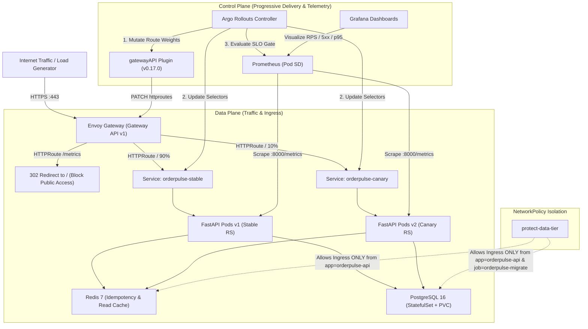
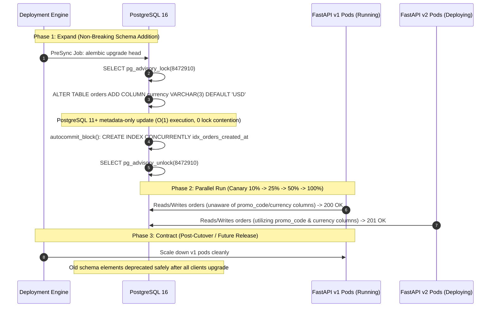
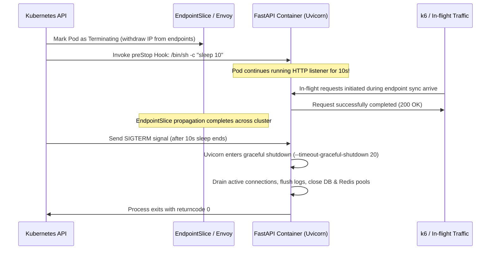

# OrderPulse Architecture Deep Dive

OrderPulse is a production-grade, stateful progressive delivery platform implementing zero-downtime canary rollouts, backward-compatible database migrations, and automated SLO-gated rollbacks on Kubernetes.

---

## 1. High-Altitude Topology



---

## 2. Ingress & Traffic Routing (Gateway API vs. Ingress-NGINX)

### Why Gateway API Replaces Ingress-NGINX
1. **End-of-Life of Ingress-NGINX**: The community `kubernetes/ingress-nginx` controller officially reached End-of-Life in March 2026. Forward-looking cloud-native platforms standardize on the official Kubernetes Gateway API (`gateway.networking.k8s.io`).
2. **Role-Oriented Design**: Gateway API cleanly separates cluster infrastructure (`GatewayClass`, `Gateway`) owned by Platform/SRE teams from routing rules (`HTTPRoute`) owned by Application teams.
3. **First-Class Traffic Splitting**: Unlike legacy Ingress annotations (`nginx.ingress.kubernetes.io/canary-weight`) which suffer from fragmentation and poor controller portability, Gateway API defines multi-backend weighted distribution as a core native specification:
   ```yaml
   backendRefs:
     - name: orderpulse-stable
       port: 80
       weight: 90
     - name: orderpulse-canary
       port: 80
       weight: 10
   ```
4. **xDS Dynamic Reconfiguration**: Envoy Gateway translates `HTTPRoute` rules into Envoy xDS configuration dynamically over gRPC. Routing weights update in milliseconds without reloading proxy processes or dropping persistent TCP keep-alive connections.

---

## 3. Database Evolution: The Expand-and-Contract Pattern

Deploying stateless containers with zero downtime is trivial; deploying stateful systems where v1 and v2 run concurrently against a single shared database is where real-world downtime occurs.

OrderPulse implements the **Expand-and-Contract (Parallel Run)** database migration pattern.



### Key Migration Invariants
1. **Session-Level Advisory Locking (`pg_advisory_lock`)**:
   Prevents multiple concurrent migration jobs (e.g., from retries or parallel CI triggers) from interleaving DDL statements.
2. **Instant Metadata Updates**:
   Adding columns with non-volatile defaults (`DEFAULT 'USD'`) in PostgreSQL 11+ is an instantaneous table-metadata change that does not rewrite table rows or acquire exclusive table locks.
3. **`CREATE INDEX CONCURRENTLY` in `autocommit_block()`**:
   Standard index creation holds an `EXCLUSIVE SHARE` lock that blocks all incoming `INSERT` and `UPDATE` queries. Concurrently building the index scans the table without blocking live transaction throughput.

---

## 4. Packet-Draining Pod Lifecycle (Zero Dropped Connections)

When a pod is scheduled for termination during downscaling, Kubernetes executes two actions in parallel:
1. Removes the pod IP from `EndpointSlices` / kube-proxy iptables.
2. Sends `SIGTERM` to the container process.

Because propagating endpoint updates to Envoy Gateway and Linux conntrack takes ~1–2 seconds, sending `SIGTERM` immediately causes in-flight HTTP requests to fail with `502 Bad Gateway` or `Connection Reset`.

### OrderPulse Termination Sequence



### Server Timeout Alignment
- `Envoy Gateway Idle Timeout`: 60 seconds
- `Uvicorn keep-alive timeout`: `--timeout-keep-alive 65` (exceeds proxy idle timeout to eliminate race-condition resets)
- `Uvicorn graceful shutdown`: `--timeout-graceful-shutdown 20`
- `Pod termination grace period`: `terminationGracePeriodSeconds: 30`

---

## 5. Automated SLO Gate & Failure Blast Radius

Argo Rollouts queries Prometheus metrics scoped exclusively to the canary pod hash (`rollouts_pod_template_hash`).

### Metric 1: HTTP 5xx Error Rate (< 1%)
```promql
(
  sum(rate(http_requests_total{namespace="deployment-engine", rollouts_pod_template_hash="{{args.canary-hash}}", status_code=~"5.."}[2m]))
  or vector(0)
)
/
clamp_min(
  sum(rate(http_requests_total{namespace="deployment-engine", rollouts_pod_template_hash="{{args.canary-hash}}"}[2m]))
  or vector(0.001),
  0.001
)
```

### Metric 2: p95 Latency (< 250ms)
```promql
histogram_quantile(
  0.95,
  sum by (le) (
    rate(http_request_duration_seconds_bucket{namespace="deployment-engine", rollouts_pod_template_hash="{{args.canary-hash}}"}[2m])
  )
) or vector(0)
```

### Auto-Rollback Safeguards
- **Evaluation Interval**: Every 20 seconds
- **Failure Limit**: 2 consecutive failures
- **Detection Window**: ~40–60 seconds
- **Blast Radius**: Maximum 10% of total external traffic is exposed to the faulty release before automatic rollback triggers and resets traffic to 100% stable.
